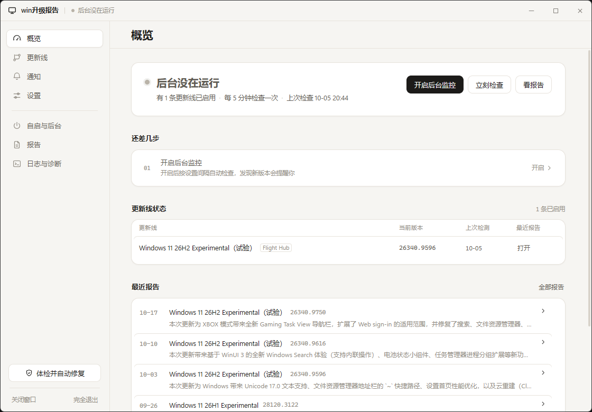
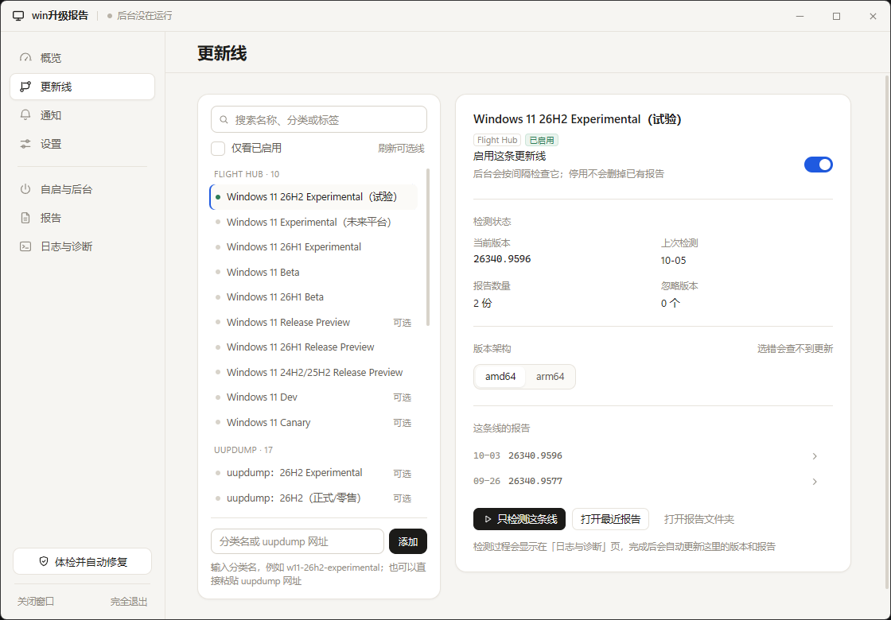
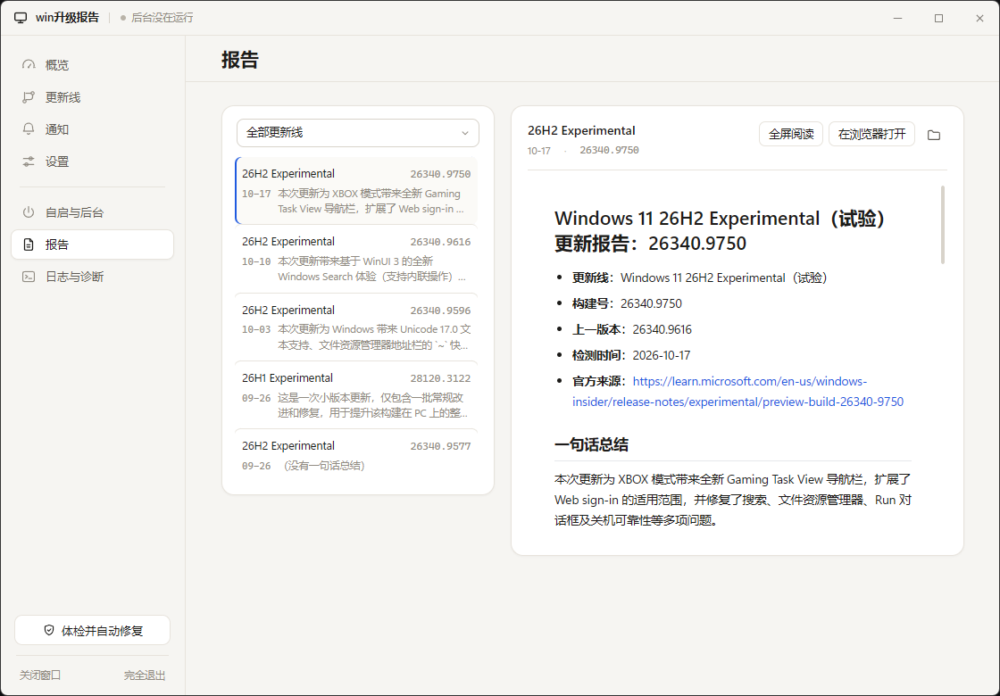
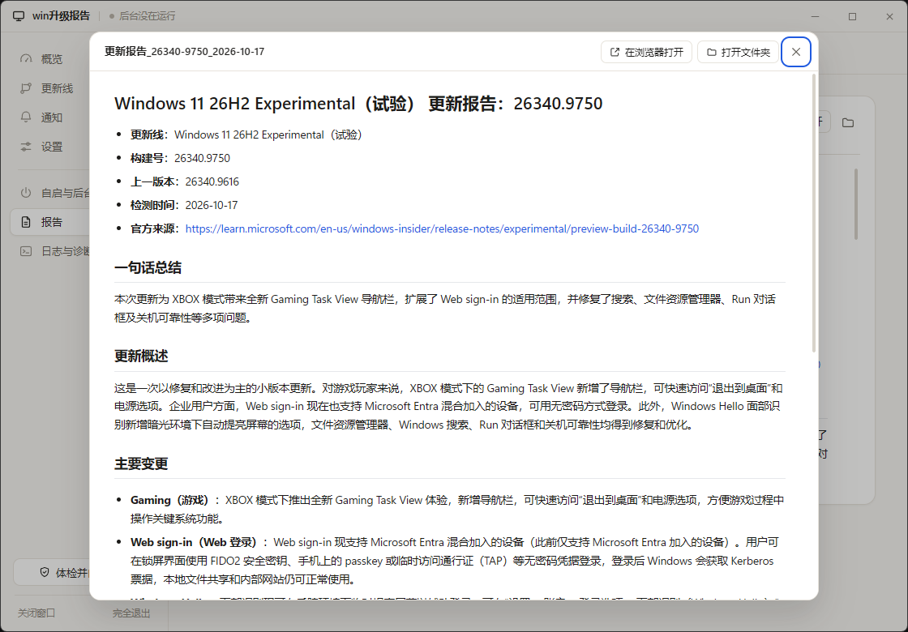

# win升级报告

静默盯着你挑的 Windows 更新线（任意 Insider 频道 / 正式版线）：登录后常驻一个小小的**哨兵**，
每隔几分钟问一次微软官方看板「变了没有」。一旦微软发布新构建，就用 DeepSeek 把官方发布说明
整理成一份简短的中文 Markdown 报告，然后弹一条 Windows 通知。点通知就能看到排版好的报告。

从「微软发布」到「你收到通知」通常 **2 ～ 5 分钟**（其中 AI 总结占 30～90 秒）。
以前是每天 12:00 查一次，经常要等到第二天中午才知道；现在不用等了。

判断、比对、解析全是普通代码；**AI 只用来总结官方说明**——没新版本时一次都不调，
同一个版本也只调一次。检测过程没有窗口、没有提示音、不打扰你；
**只有真的出了新版本才通知一次**。玩游戏时会彻底静默（详见下文）。

## 界面预览

设置窗口是一个**原生窗口**（WebView2 渲染，无浏览器、无地址栏），连 Windows 标题栏都是自绘的：
拖动标题栏移动、双击最大化、四边四角缩放，最小化/最大化/关闭全部由界面接管。

| 概览 | 更新线 |
| --- | --- |
|  |  |

| 报告（窗口内阅读） | 全屏阅读 |
| --- | --- |
|  |  |

更多截图（通知 / 自启与后台 / 日志与诊断 / 最大化 / 960 宽）见
[`docs/screenshots/`](docs/screenshots/)。

## 下载与安装（绿色文件夹版）

到 [Releases](https://github.com/zcy83821448/win-upgrade-report/releases/latest) 下载
`win-upgrade-report-*-green.zip`，解压到任意位置（桌面、D 盘、U 盘都行），
双击里面的 `win升级报告.exe` 就是设置窗口。**不用安装，也不需要管理员权限。**

设置窗口是一个**原生窗口**：没有浏览器、没有地址栏、没有网页标签，整个窗口
（包括标题栏、最小化/最大化/关闭按钮）都是程序自己画的，拖动标题栏就能移动，
四边和四角可以缩放。界面用 WebView2 渲染，Win10/11 一般自带；老机器缺了会提示装一下
Edge WebView2 Runtime。

数据（`config.json`、报告、日志）就存在这个文件夹里，所以整个文件夹可以直接拷到别的电脑接着用。

> **为什么是文件夹而不是一个 exe**：把整个程序压成一个 exe 的话，每次启动都要
> 先解压到 `%TEMP%\_MEIxxxx`，启动慢，而且容易被临时文件清理工具、杀毒软件干扰，
> 冒出 `Failed to start embedded python interpreter` / `Failed to remove temporary directory`
> 这类看不懂的报错。文件夹版没有解压这一步，整类问题从根上不存在。

想让它在后台一直盯着：进「自启与后台」页点「一键设置开机自启」（免管理员权限），
或者点「安装 / 更新计划任务」用计划任务（更稳，崩了会自动重启，但要弹一次 UAC）。

**出问题先点左侧栏底部的「体检并自动修复」** —— 它会自己检查 8 项、能修的直接修掉，
然后用人话告诉你结果，详见下文。

## 支持哪些更新线

设置界面「更新线」页可以直接勾选，两类来源：

| 来源 | 覆盖范围 | 为什么用两套 |
| --- | --- | --- |
| **微软 Flight Hub**（`learn.microsoft.com/windows-insider/flight-hub/`） | 所有 Insider 频道：26H2 Experimental、26H1 Experimental、未来平台、Beta、26H1 Beta、Release Preview（26H1、24H2/25H2） | 这是微软官方看板，既能拿到构建号，也能**直接拿到该构建官方发布说明的精确链接**，最可靠 |
| **uupdump**（`uupdump.net`） | 正式版 / 零售版本线：26H2、25H2、24H2、23H2…… 以及 Server | Flight Hub 不管正式版线，这些只有 uupdump 有 |

两条来源的构建号判定标准一样：**构建号变大 = 有新版本**（例如 28120.3002 → 28120.3122）。
每次运行还会顺带把 Flight Hub 上新出现的频道自动收进列表（默认不启用，勾一下就能用）。

## 它是怎么跑的

```
计划任务(登录时启动, 隐藏窗口, 不限时, 崩了自动重启)
  └─ pythonw watch.py                     ← 常驻哨兵，一直开着
       ├─ 每 5 秒醒一次（实测一次判定约 0.26 毫秒，可以忽略）
       │    ├─ 看用户是不是在玩全屏游戏 → 是就彻底静默
       │    └─ 看看设置界面有没有留言说「立刻检测」
       ├─ 到点（默认 5 分钟）问 Flight Hub「上次之后变了没有」   ← 这一步不调 AI
       │    没变化 → 服务器回 304，传输 0 字节，直接接着睡
       │    变了 ↓
       └─ 调 checker.run_check()（同一个进程里直接调，不另起进程）
            ├─ 1. 解析看板，拿到每条线的最新构建号
            ├─ 2. 和 state.json 里记录的版本比（按构建号大小）
            │     没变 → 不写日志、不通知，静默结束
            │     变了 ↓
            ├─ 3. 取该构建的微软官方发布说明原文（Flight Hub 直接给了精确链接）
            ├─ 4. 把原文丢给 DeepSeek 写成中文 Markdown        ← 只有这一步用 AI
            ├─ 5. 存到 reports\<更新线>\更新报告_构建号_日期.md，更新总览页
            ├─ 6. 先把检测结果落盘，再发那条唯一的通知
            └─ 7. 通知 ──点击──> winupdrept: 协议 → viewer.py → 渲染成网页打开
```

**为什么快**：哨兵只问「变了没有」。没变化时微软服务器回 `304`，**传输 0 字节**，
连 HTML 都不解析、AI 更不会碰一下。所以每 5 分钟问一次、一天 288 次，没新版本时流量是 0。

**为什么只花一次 AI**：判断有没有新版本、比构建号、解析页面，全是普通代码。
AI 只在「确认出现新版本」之后被调用一次，而且同一个版本只调用一次
（`state.json` 里 `reported_version` / `notified_builds` 各记一笔）。

**为什么不会重复吵你**：发通知之前先把「已经提醒过」落盘，再发；发送失败就留着重试，
重试几次还不行才放弃（报告文件还在，总览页里看得到）。所以同一个版本最多响一次。

**想手动查一次**：设置界面点「立刻静默跑一次」。哨兵在跑的话会把请求转交给它
（这样 `state.json` 只有一个写入者，不会重复通知）；哨兵没在跑才另起一个进程。

几个刻意的设计：

- **首次运行只记基线**，不写报告也不通知——不然第一天就报一次没意义的"更新"。
- **只跟上一版比**，中间跳过的版本不会补报（关机几天回来只会告诉你最新那个）。
- 官方说明偶尔取不到（新构建刚发布、页面还没生成）：照常写报告，但会写明"未取到官方原文"，
  并附上失败原因，不会默默什么都不做。
- 通知被静默时段挡住时（可配 `23:00-07:00`），先攒着，出了时段补一条汇总通知。
- 设置界面保存后，哨兵**几秒内就重读一次配置**，间隔、游戏静默这些改完立刻生效。

**旧版对比**：以前是计划任务每天 12:00 跑一次 `checker.py`，一次跑完抓取 + AI + 通知；
还有「同一天只跑一次」和「间隔几天」的限制。那套现在都删了——哨兵取代了它，
`--check` 保留下来只作手动检测用。

## 玩游戏时彻底静默

判定到你在玩全屏游戏时，哨兵**什么都不干**：不联网、不调 AI、不通知、不写盘。
游戏一关，立刻补查一次（玩游戏期间微软要是发了新版本，这时就会通知你）。

判定规则（全是通用特征，**不需要维护游戏名单**）：

> 有窗口**铺满整块屏幕** + **没有标题栏** + 不是隐形窗口 + 不是分层叠加层
> + 不是工具窗口 + 不是桌面外壳 → 判定「在玩全屏游戏」

无边框全屏的游戏窗口正好符合这个形状，所以**无边框全屏也能认出来**。
这条规则不是拍脑袋定的：这台机器上没玩游戏时就存在 3 个铺满屏幕、没有标题栏的窗口——
`explorer.exe` 的桌面（是桌面外壳）、`TextInputHost.exe`（系统标记为隐形）、
`NVIDIA Overlay.exe`（分层叠加层）——它们各自踩中一条排除规则，会被正确放行。
另外，微软那个「现在该不该打扰用户」的官方接口在普通桌面状态下就返回「全屏忙」，
信它的话工具会**永久静默**，所以只把它当旁证，不当依据。

代价：扫一遍所有窗口约 **0.26 毫秒**，每 5 秒一次 = 单核的 **0.006%**。

误判了怎么办：设置窗口「通知」页点「**选择程序…**」，在窗口列表里挑它
（最小化的窗口也会列出来）；也可以在那一页自己填时长**手动静默**。
注意：全屏看视频、全屏放幻灯片也会被当成「别打扰」——这是有意为之，跟静默时段一个意图。

## 托盘图标：一眼看到它在不在后台跑

哨兵一启动，任务栏右下角就会出现 **win升级报告** 的托盘图标 —— **图标在 = 它在跑**。

鼠标悬停能看到状态（运行中 / 游戏静默中 / 手动静默中）和上次检查的时间。右键菜单：

```
状态：运行中
上次问官方：19:17:15
─────────────
打开设置界面          ← 双击图标也是这个
立刻检测一次
静默 2 小时
─────────────
打开报告总览
打开日志
─────────────
完全关闭后台监控      ← 点完图标就消失
```

> **看不到图标？** Windows 会把新出现的托盘图标默认放进「隐藏的图标」（任务栏那个 `∧`）里。
> 一次性设置：**设置 → 个性化 → 任务栏 → 其他系统托盘图标 → 把 win升级报告 打开**，
> 它就会一直显示在那儿。哨兵第一次挂上图标时也会弹一条气泡提醒这件事。

托盘图标为什么挂在**哨兵**身上，而不是设置界面里：设置界面是个开完就关的窗口，
图标挂它身上的话你一关窗口图标就没了，那正好回答不了「它到底还在不在后台跑」。

### 图标样式可以随便换（9 套）

`icons\` 里有 9 套样式，是**线条粗细 × 箭头占位**两个维度的组合：

| | 箭头占位：小 | 标准 | 大 |
| --- | --- | --- | --- |
| **线条：细** | 细 + 小 | 细 + 标准 | 细 + 大 |
| **线条：标准** | 标准 + 小 | **标准 + 标准（默认）** | 标准 + 大 |
| **线条：粗** | 粗 + 小 | 粗 + 标准 | 粗 + 大 |

* **线条粗细** —— 箭头线条多粗
* **箭头占位** —— 箭头在 16 像素的图标里占多大（**这个才是你眼睛感觉到的「大小」**）

在设置窗口「通知」页最下面的「**任务栏图标**」里挑（9 款，带预览），
**选完立刻生效**：哨兵每几秒重读一次配置，发现样式变了就把托盘图标现场换掉，不用重启。

> **为什么不是选「16px / 20px」**：实测你这台机器的托盘槽位就是 16×16（100% DPI），
> 屏幕上的大小由系统决定，选哪一档*分辨率*并不会让图标变大变小 —— 真正改变观感的
> 是「箭头占多大地方」，所以做成了「占位」这个维度。
> 不过每套 `.ico` 里仍然装齐了 16/20/24/32/40/48/64/256 八档，
> 换到 125% / 150% 缩放的电脑上系统会自动挑合适的那一档。

想自己改数值（线宽、占位比例、描边深浅）就动 `做图标.py` 顶上那几个常量，
然后 `python 做图标.py` 重新生成，不用碰别的代码。

## 两种关闭方式

设置窗口的标题栏是自绘的：右上角三个按钮是最小化 / 最大化 / 关闭，
左侧栏底部是「关闭窗口」和「完全退出」。点关闭按钮**不会再弹确认框**，点哪个就干哪个。

| 怎么关 | 效果 |
| --- | --- |
| **关闭窗口**（标题栏 × / 左侧栏「关闭窗口」） | 只关设置窗口。后台哨兵继续跑，托盘图标还在，有新版本照样通知你。随时双击托盘图标就能重新打开设置。 |
| **完全退出**（左侧栏底部） | 连后台哨兵一起停掉：托盘图标消失，以后开机也不会自动启动。想恢复：重新打开程序，点概览页右上角的「开启后台监控」。 |
| **最小化 / 最大化** | 和普通窗口一样；拖动标题栏移动窗口，拖四边四角缩放，双击标题栏最大化/还原。 |

「完全关闭」不是简单把进程杀掉 —— 它会**先把配置开关关掉，再让哨兵自己干净退出**。
这样即使计划任务把它重新拉起来，它一启动就会自己退出，不会出现「关了又自己回来」。

> 自绘窗口没有 Windows 的 Aero Snap（拖到屏幕边缘自动分屏）—— 这是无边框窗口的取舍。
> 最大化、最小化、缩放都正常。

## 性能占用（实测数据）

| 项目 | 数值 |
| --- | --- |
| 常驻内存 | **25.7 MB**（空 Python 14.3 + 工具自己的模块 11.4；纯标准库，没有图形库） |
| 设置窗口 | 只在打开时占用（WebView2 约 60～100 MB）；关掉窗口就释放，后台哨兵仍是 25.7 MB |
| 轮询（没变化） | 传输 **0 字节**，约 0.3 秒（基本都在等网络），真占 CPU 约 0～16 毫秒 |
| 轮询（有变化） | 传输 113 KB，解析整页约 3～6 毫秒 |
| 游戏判定 | 每次 **0.26 毫秒**；每 5 秒一次 = 每天约 5.4 秒 CPU = 单核 0.006% |
| 磁盘写入 | 没变化时**不写任何文件**；有新版才写一份报告 |
| AI 调用 | 没新版本 **0 次**；一个新版本恰好 **1 次** |
| 托盘图标 | 一个隐藏窗口 + 一个线程，跟哨兵**同一个进程**，内存增量可忽略 |
| 启动开销 | 绿色文件夹版不需要解包，冷启动约 0.2～0.5 秒（设置窗口再算上 WebView2 约 1 秒） |

唯一新增的常驻成本是那约 26 MB 内存（玩游戏时也不会释放——Python 不还内存给系统），
但除了占着这点内存，它什么都不做。

## 应用程序（打包成 exe）

`应用程序\win升级报告\` 是打包好的绿色文件夹版（自带 Python 运行时和 WebView2 外壳，
换台电脑不用装任何东西，Win10/11 自带 WebView2 Runtime）。双击里面的
`win升级报告.exe` 就是设置窗口。

```
应用程序\
  win升级报告\                 ← 整个文件夹可以直接拷走
    win升级报告.exe            双击 = 设置窗口；计划任务、通知协议都指向它
    _internal\                 运行库（别删，删了程序起不来）
    webui\                     设置界面（HTML / CSS / JS，原生窗口里渲染）
    使用说明.txt
    config.json / state.json / reports\ / logs\   你的数据（首次运行后出现）
  绿色版.zip                  发布用压缩包（不含你的 Key 和历史数据）
```

它按参数分流：

| 命令 | 作用 |
| --- | --- |
| `win升级报告.exe` | 设置窗口 |
| `win升级报告.exe --watch` | **常驻哨兵**（计划任务 / 登录自启用的就是这个；没窗口，带托盘图标） |
| `win升级报告.exe --watch --status` | 看哨兵现在活着没有：在线状态、模式、上次问官方的时间、托盘有没有挂上 |
| `win升级报告.exe --watch --once` | 只跑一轮就退出（排查用） |
| `win升级报告.exe --watch --no-tray` | 不挂托盘图标（排查图标相关问题时用） |
| `win升级报告.exe --check` | 手动跑一次检测（不经过哨兵） |
| `win升级报告.exe --list-channels` | 列出更新线和当前记录 |
| `win升级报告.exe --view index` | 打开报告总览页（浏览器，报告是文档） |
| `win升级报告.exe --task query` | 查计划任务状态（含限时设置，能看出任务会不会被定时杀掉） |
| `win升级报告.exe --task install` | 装哨兵任务，顺手卸掉旧的每日任务（弹 UAC） |
| `win升级报告.exe --selftest --with-gui` | 自检，结果写到 `logs\自检报告.txt` |

**数据放哪**：exe 会先找自己同目录有没有 `config.json`，没有就找上一级目录——所以现在
`config.json / state.json / reports / logs` 仍在 `win升级报告\` 这一层，exe 自动用它们。
把这几样一起拷进 `应用程序\win升级报告\` 里，这个文件夹就成了完全独立、能整体拷走的绿色版。

**重新打包**：改了源码（或 `webui\` 里的界面）后跑 `python 打包.py`（`--zip` 顺带压发布包，
`--verify` 打完自检一遍）。重新打包会**保留**目标文件夹里已有的 `config.json / state.json /
reports / logs`，不会把用户的 Key 和历史报告清掉；发布 zip 里则不含这些数据。

## 怎么用

1. 双击 **应用程序\win升级报告\win升级报告.exe**（或根目录的 `打开设置界面.bat`）。
2. **更新线**页：点「刷新可选线」从 Flight Hub 抓频道列表 → 勾选要盯的线（默认已启用
   26H2 Experimental）→ 还可以在底部加自定义 uupdump 分类。
3. **设置**页：在「API Key」框里粘贴你的 Key（从
   [platform.deepseek.com](https://platform.deepseek.com/api_keys) 拿），点「测一下 Key 能不能用」。
   Key 只存在本机 `config.json` 里，不会上传到任何地方。
4. **通知**页：设「多久检查一次」（默认 5 分钟）、确认「全屏时先别打扰我」是开着的；
   静默时段、托盘图标样式、报告详细程度也在这里。
5. **自启与后台**页：点「一键设置开机自启」（免管理员权限）；想更稳就点
   「安装 / 更新计划任务」（弹一次 UAC）。装完这一页会显示后台的运行状态。
6. 回到**概览**页，点右上角「开启后台监控」。它就开始盯着了。
7. 想看报告：**报告**页直接排序浏览、点开即可在窗口内读，不用跳浏览器。

> **不用点保存**：改完任何一个设置都会自动保存（左侧栏底部会闪一下「已保存 19:42」）。
> 间隔、游戏静默这些改完就生效，**不用重装计划任务**：哨兵每几秒会重读一次配置。

## 界面各页说明

窗口左侧是 7 个页签；最上方是自绘标题栏（拖动、最小化/最大化/关闭），
左侧栏底部有「体检并自动修复」和关闭入口。

| 页 | 内容 |
| --- | --- |
| **概览** | 后台状态大卡片（在不在跑、在盯哪几条、每几分钟、上次检查/上次新版本）、缺什么的一步步提示、各条线当前版本、最近报告、体检入口 |
| **更新线** | 全部可选频道（搜索 + 只看已启用）、勾选启停、选中看详情（当前版本/上次检测/忽略列表/架构）、单条线立即检测、打开报告/文件夹、忽略某版本、添加自定义 uupdump 分类 |
| **通知** | 检查间隔、通知开关、多线合并、失败几次后提醒、静默时段、**全屏时彻底静默**（含手动静默、忽略名单）、9 款托盘图标样式（带预览）、报告详细程度 / 是否附官方原文 / 保留份数 |
| **设置** | API Key（必填，可显隐、可测）、AI 服务地址、模型、思考模式、max_tokens / temperature / 超时 / 重试 / 并发数 / 代理、原文上限、自动收录新频道 |
| **自启与后台** | 后台现在跑没跑、托盘图标状态、办法一「一键设置开机自启」（免 UAC）、办法二「安装/更新计划任务」、现在就跑起来、通知/协议注册、桌面与开始菜单快捷方式 |
| **报告** | 按更新线筛选报告列表（构建号 / 日期 / 一句话总结），点开在窗口内阅读；也可「在浏览器打开」或「打开文件夹」 |
| **日志与诊断** | 实时看 `logs\checker.log`（含手动检测的实时输出）、清空日志、打开日志文件、体检结果列表 |

## 文件说明

| 文件 | 作用 |
| --- | --- |
| `应用程序\win升级报告\` | 打包好的绿色文件夹版（原生窗口界面 + 哨兵 + 托盘，全都在这一个文件夹里） |
| `app.py` | exe 的入口，按参数分流到界面 / 检测 / 查看器 |
| `打包.py` | 用 PyInstaller 重新打包到 `应用程序\`（会保留用户数据） |
| `gui.py` | 设置界面的后端：pywebview 原生窗口 + JS API（窗口控制、配置读写、检测/体检/自启等动作） |
| `webui\` | 设置界面的前端：`index.html` / `app.css` / `app.js`（原生 JS，无框架、无 CDN） |
| `打开设置界面.bat` | 源码方式打开设置窗口 |
| `checker.py` | 检测核心：`run_check()` 是唯一「干活」的地方，手动检测和哨兵共用它 |
| `watch.py` | **常驻哨兵**：每几秒醒一次，问官方看板「变了没有」、判断游戏静默、发通知、管托盘图标 |
| `tray.py` | 系统托盘图标（纯 ctypes 调 Win32 的 Shell_NotifyIcon，不依赖 pystray/Pillow）。挂上/换图标/更新提示/右键菜单/移除都在这里 |
| `做图标.py` | 生成 `icons\` 里的 9 套图标样式 + 预览图 + `styles.json`（想调粗细/占位就改它顶上的常量） |
| `icons\` | 托盘图标样式：9 套 `.ico`（每套含 8 档尺寸）、9 张界面预览图、`styles.json` 清单 |
| `gamesense.py` | 游戏/全屏判定（铺满屏幕 + 无标题栏 + 排除系统壳与叠加层） |
| `channels.py` | 更新线定义、Flight Hub 页面解析、预设频道表 |
| `source.py` | 所有抓取：Flight Hub（含 `Conditional` 条件请求：没变化时服务器回 304、传输 0 字节）、uupdump、官方发布说明（三级回退 + 重试 + 代理 + opener 复用） |
| `deepseek_api.py` | DeepSeek 调用、提示词模板、兜底报告 |
| `reporter.py` | 写报告、按频道归档、清理旧报告、生成总览页 |
| `notify.py` / `toast.ps1` | Windows 通知 + 注册 AUMID 和 `winupdrept:` 协议 |
| `viewer.py` | 通知点击后打开的查看器（Markdown → 排版好的网页） |
| `mdlite.py` | 自带的极简 Markdown 渲染（无第三方依赖） |
| `task.ps1` | 计划任务注册/删除（PowerShell 计划任务模块）。`-Mode watch` 装的是哨兵任务：登录时启动、`ExecutionTimeLimit=PT0S`（不限时）、崩了 1 分钟后自动重启、忽略空闲和电池设置；`-Mode daily` 是旧版，保留但不再使用 |
| `config.json` | 所有设置（含更新线列表） |
| `state.json` | 每条线的当前版本、已写报告的版本、**已提醒过的版本**（同一版本只吵一次）、报告历史、忽略列表、失败计数 |
| `logs\watch.json` | 哨兵的「心跳」：进程号、当前模式（正常/游戏静默）、上次问官方的时间、累计次数。设置界面靠它显示「哨兵：运行中」 |
| `logs\check_now.req` | 界面上点「立刻静默跑一次」时留的请求文件，哨兵取走即删 |
| `reports\<更新线>\` | 各条线的报告（`.md` 原件 + `.html` 渲染页） |
| `reports\总览.html` | 所有报告的时间线 + 各线当前基线 |
| `logs\checker.log` | 运行日志，出问题先看它 |

## 命令行

```bat
python watch.py --status                     看哨兵状态（在线？在游戏静默？上次什么时候问的）
python watch.py --once --verbose             只跑一轮，过程打印到控制台（排查用）
python checker.py --list-channels            列出所有更新线和当前记录
python checker.py --dry-run --verbose        只抓数据看会做什么，不调 API、不写文件、不通知
python checker.py --only fh:experimental --dry-run --verbose   只测某一条线
python checker.py --no-notify                跑但这次不通知
python gamesense.py                          看现在有没有被判定成「在玩游戏」，以及扫一次多快
python notify.py --test                      发一条测试通知
python viewer.py index                       打开总览页（也可 folder / log / r/<线>/<构建号>）
```

## 可调参数（config.json）

| 键 | 默认 | 说明 |
| --- | --- | --- |
| `channels` | 26H2 Experimental | 更新线列表：`source` = flighthub / uupdump，`enabled` 是否监控，`arch` 架构偏好 |
| `watch_enabled` | `true` | 哨兵开关 |
| `watch_interval_minutes` | `5` | 每隔几分钟问一次官方看板 |
| `tick_seconds` | `5` | 哨兵醒来的间隔（顺便用来响应「立刻检测」和游戏判定） |
| `game_mode_enabled` | `true` | 玩游戏时彻底静默 |
| `game_exit_hold_seconds` | `60` | 连续这么久判定「没在玩」才退出静默（防切进切出乱弹） |
| `game_ignore` | `[]` | 忽略名单（进程名），误判时加进来 |
| `tray_style` | `std-std` | 托盘图标样式（`icons\styles.json` 里的 id，如 `thin-sm` / `bold-lg`）；设置界面下拉框直接改 |
| `tray_hint_shown` | `false` | 托盘图标第一次挂上时弹一次气泡提示，只提示一次 |
| `silent_until` | 空 | 手动静默的截止时间（设置界面/托盘按钮写它） |
| `check_time` / `interval_days` / `check_at_logon` / `run_once_per_day` | 旧值 | **v2 遗留项，已不再使用**，只为了让老配置能正常读出来；`--check` 也不再受它们限制 |
| `quiet_hours` | 空 | 静默时段，如 `23:00-07:00`；期间的通知攒到时段外补发 |
| `api_key` | 空 | DeepSeek 的 Key，在设置窗口「设置」页填，存本机 `config.json` |
| `model` / `disable_thinking` | `deepseek-flash` / `true` | 模型与思考模式开关 |
| `detail` | `标准` | 报告详细程度：简短 / 标准 / 详细 |
| `include_official_text` | `false` | 报告末尾附官方原文全文 |
| `open_report_on_click` | `false` | 点报告时直接用系统浏览器打开；关着就在界面里读 |
| `merge_notifications` | `true` | 一次多条线更新时合并成一条通知 |
| `notify_on_error_after` | `3` | 连续失败几次后发一次错误通知，0 = 不发 |
| `proxy` | 空 | 例如 `http://127.0.0.1:7897`，留空直连 |
| `retries` | `2` | 网络请求重试次数 |
| `max_workers` | `4` | 并发抓取的线程数（1 = 串行）。多条更新线时同时抓，日志顺序不受影响 |
| `keep_reports` | `200` | 每条线最多保留多少份报告 |
| `auto_discover_channels` | `true` | 自动收录 Flight Hub 上新出现的频道（默认不启用） |

## 已知限制 / 排错

- **设置窗口需要 WebView2 Runtime**：Win11 和较新的 Win10 自带；老系统第一次打开如果提示缺
  WebView2，装一下微软的 [Edge WebView2 Runtime](https://developer.microsoft.com/microsoft-edge/webview2/)
  即可（后台哨兵不依赖它，只有设置窗口需要）。
- **自绘窗口没有 Aero Snap**：无边框窗口拖到屏幕边缘不会自动分屏（最大化/最小化/缩放正常）。
- **通知可能被专注助手/勿扰吞掉**：控制面板 → 系统 → 通知，确认「win升级报告」没被静音。
- **怎么知道哨兵还活着**：设置窗口「概览」页顶部状态卡片；「自启与后台」页显示后台状态；
  命令行 `win升级报告.exe --watch --status`。它每 30 秒写一次心跳到 `logs\watch.json`，
  超过 60 秒没动静就算停了。窗口程序没有控制台，出问题看 `logs\checker.log` 里 `[哨兵]` 开头的行。
- **任务被系统定时杀掉了**：这是最容易踩的坑。计划任务的默认「限时」是 3 天、旧脚本里写死了
  30 分钟，常驻程序到点就会被终止，表现成「刚还能用，过一会儿就没动静了」。
  现在安装时设成 `ExecutionTimeLimit=PT0S`（不限时）+ 崩了 1 分钟后自动重启；
  `--task query` 能直接看到 `LIMIT=` 是不是 `PT0S`，界面上如果限时不对也会显红字提示重装。
- **没收到通知怎么排查**：
  1. `--watch --status` 看哨兵是否在线、是不是卡在游戏静默；
  2. 看 `logs\checker.log` 里最近有没有 `★ 发现新版本`；
  3. 游戏静默期间发现的版本会在游戏关闭后立刻补查；`quiet_hours` 期间发现的会攒着补发，
     `state.json` 的 `pending_notify` 能看到攒了几条。
- **同一个版本会不会重复通知**：不会。发通知前先把「已提醒」写进 `state.json`（`notified_builds`），
  所以重启哨兵、重复登录、再手动检测一次，都不会重复响。
- **关机几天回来只报一个版本**：这是有意设计的（只跟上一版比，不补报中间跳过的版本）。
- **玩游戏时它真的什么都不干吗**：是。判定为游戏静默后不联网、不调 AI、不通知、不写盘，
  只留着那个 5 秒一次、每次 0.26 毫秒的判定。游戏一关立刻补查一次。
- **改了 `.ps1` 里的中文注释后通知失灵**：PowerShell 5.1 要求 `.ps1` 带 UTF-8 BOM，
  程序启动时会自动补 BOM（`notify.ensure_bom`）。手动编辑后如果报"找不到参数名"，就是这个原因。
  （另外 PowerShell 参数别叫 `$Args`——那是自动变量，会被静默吃掉，所以用的是 `$Arguments`。）
- **uupdump / Flight Hub 改版**：日志会写"没解析到任何版本/频道"，改 `source.py` 里的正则。
- **想重报某个版本**：在「更新线」页选中该线 →「清除忽略」，或删掉 `state.json` 里该频道的
  `last_version` 再跑一次 `--force`。
- **换到别的时间线**：勾选时自动按构建号大小判断，不会因为换线而产生错误比较；但建议清掉该线
  `last_version` 重新建基线。
- **exe 被杀软拦**：PyInstaller 程序常被误报，加个白名单即可；这也是不用安装包的原因。
- **exe 启动比源码慢一点**：设置窗口要等 WebView2 起来，约 1 秒（后台哨兵不受影响）。

## 构建者

| 角色 | 谁 |
| --- | --- |
| 需求、设计取舍、试运行与验收 | [@zcy83821448](https://github.com/zcy83821448) |
| 代码实现、文档编写 | Claude Code（Anthropic） |

这个工具是**结对写出来的**：上面每个模块、这份 README、`打包.py` 都是在对话里一轮一轮长出来的。
作者定需求、跑真实环境、指出哪里不对；Claude Code 负责查资料、写实现、改 bug。
抓取失败怎么降级、通知怎么防打扰、报告模板怎么定，都是两边来回磨出来的。

## 开源协议

本项目采用 [MIT License](LICENSE) 开源：可以自由使用、修改、分发，保留版权声明即可。

